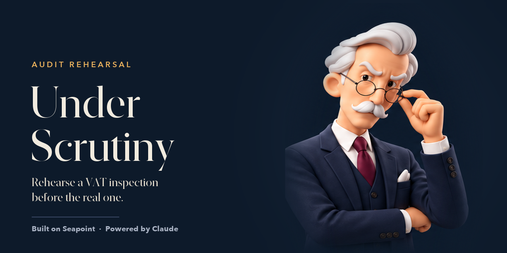
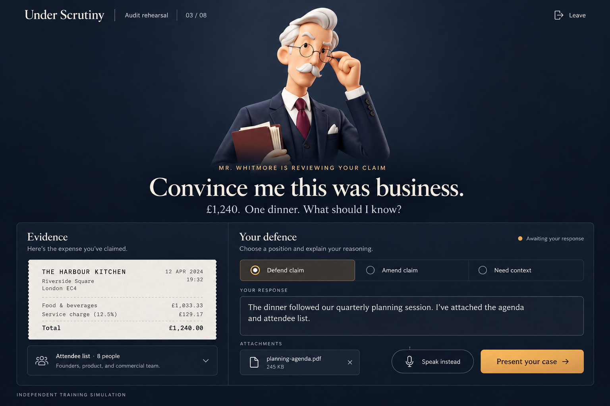

<p align="center">
  
</p>

<p align="center">
  <a href="https://lukataylo.github.io/under-scrutiny/"><b>▶ Play it in your browser</b></a>
  &nbsp;·&nbsp; Seapoint FinOps Hackathon · London · 20 Oct 2026
</p>

---

**Under Scrutiny** lets a startup founder rehearse a VAT inspection before a real one happens. Mr. Whitmore, a fictional inspector, works through real expense claims pulled from the company's Seapoint books: a dinner with VAT reclaimed, a payment to the accountants made twice, a fee nobody can name, a foreign subscription that may need a reverse charge. For each claim you defend it (out loud or in writing, with evidence), pick a correction, or ask for the rule. At the end you see what to put right, how much less it costs to correct it yourself than to be caught, and a list of corrections ready for your accountant.

<p align="center">
  
  <br><sub>Design mockup. The playable version uses the sandbox claims below.</sub>
</p>

## How a claim plays out

| You choose | What happens |
|---|---|
| **Defend claim** | Make your case in writing or with **Speak instead**, and attach evidence. Weak defences get pressed once. Bluffing gets marked **evasive**. |
| **Amend claim** | Pick a correction from a short list. Each option shows its £ effect, and some are tempting and wrong. |
| **Need context** | He explains the rule that applies. The claim stays open. |

The rehearsal makes one point: being honest early is cheaper than being caught. Penalties for careless errors you correct yourself can be nil. Evasive answers are treated as deliberate, and deliberate penalties run up to 70%.

## Meet Mr. Whitmore

He reacts to every answer.

<p align="center">
  
</p>

| Pose | When you'll see it |
|---|---|
| Suspicious | asking about a claim |
| Reading | when you attach evidence |
| Thinking | while your defence is judged |
| Pressing | when a defence lacks facts |
| Explaining | giving the rule, or after you amend |
| Stern | when an answer is marked evasive |
| Pleased | when a claim is accepted |

## The eight claims in this demo

All are real transactions from the Seapoint hackathon sandbox (Hackathon Master Ltd).

| Claim | Why he asks |
|---|---|
| Hawksmoor, £286 | VAT reclaimed on a dinner. Staff or clients? |
| Connolly Accountants, 2 × £1,800 | Paid twice on the same day, with VAT claimed twice |
| Unknown Management Fee Vendor | Six payments nobody can name, up from £77 to £217 |
| Slack, £486 | Did they actually charge UK VAT, or is it a reverse charge? |
| Eight meals, £748.60 | All coded as entertainment, all with VAT back |
| Wise, £46.28 | A trick question: it's correct as booked |
| Premier Inn, £89 | Uncategorised. Business trip, or a night off? |
| Currys, £62.34 | Uncategorised, with no receipt |

## How it's built

- **One static page.** `index.html` plus eight character images in `character/`. No backend, no build step to run it.
- **Voice.** Mr. Whitmore speaks through the browser's text-to-speech. **Speak instead** uses the browser's speech recognition; use Chrome and allow the microphone.
- **Two judges.** On this page, built-in rules judge your answers. In the claude.ai version, Claude plays the inspector, judges free-text defences against the claim's facts and the VAT rule, and can't be talked round by charm, urgency or claimed authority.
- **Generated by a Claude Code skill.** The `under-scrutiny` skill:
  1. reads the books through the **Seapoint MCP** (transactions, receipt status, account codes, tax rates)
  2. picks the 6–8 claims an inspector would pick
  3. writes the case file and builds this page

  It only reads and drafts; it never changes the books.

### Run it locally

```bash
git clone https://github.com/lukataylo/under-scrutiny.git
cd under-scrutiny
python3 -m http.server 8000
# open http://localhost:8000 in Chrome
```

## Disclaimer

Independent training simulation. Mr. Whitmore is fictional, and this project is not affiliated with HM Revenue & Customs. Penalty figures are simplified from HMRC's published inaccuracy penalty ranges and are not tax advice. The figures come from Seapoint's hackathon sandbox, not a real company.
